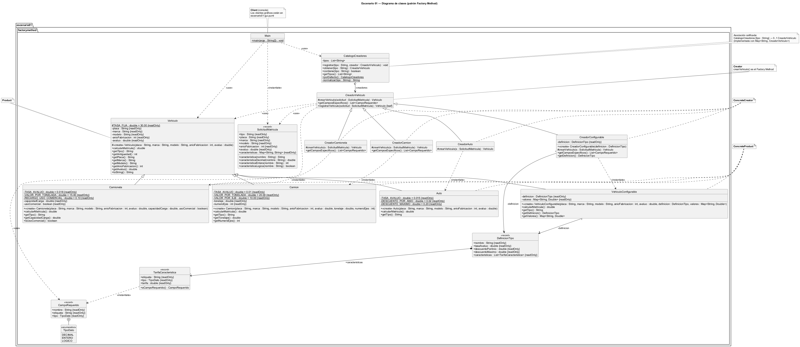
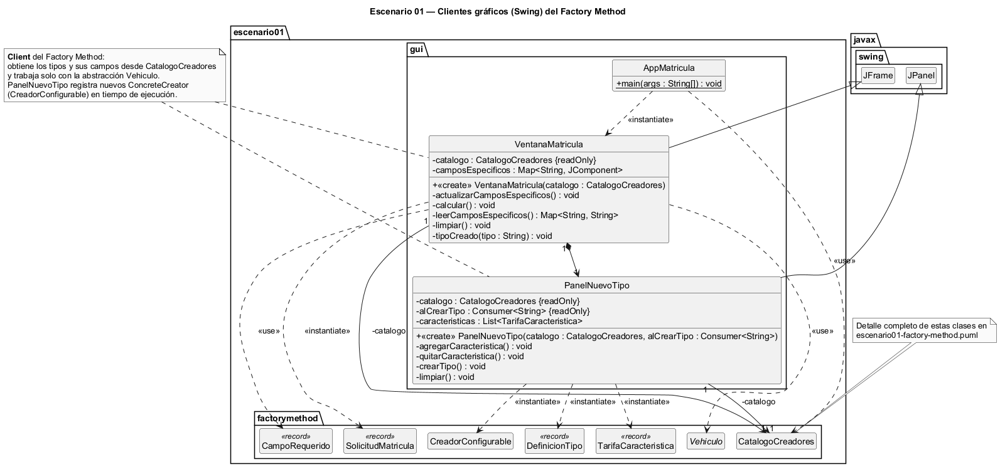
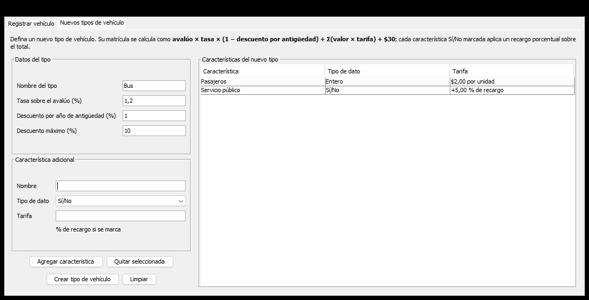
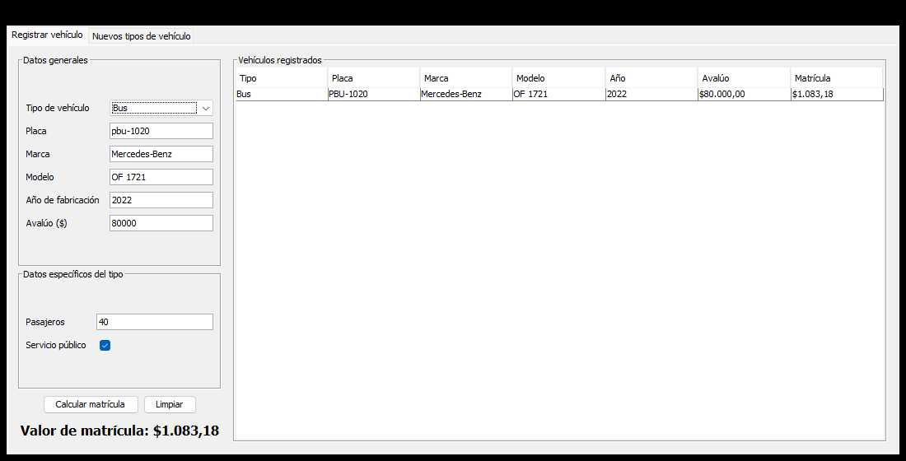

**Maestría en SOFTWARE**

**Asignatura:** Patrones de Diseño de Software  
**Actividad #:** 01 — Patrones creacionales  
**Docente:** Mauricio Ortiz Ochoa

---

**Actividad de aprendizaje #: 01**

# Patrones creacionales

## Resultado de aprendizaje

- RA1. Selecciona y aplica patrones creacionales para resolver problemas de creación de objetos, revisando críticamente las alternativas elaboradas con apoyo de inteligencia artificial.

## Instrucciones:

### Escenario 01

> Una empresa desarrolla una aplicación para registrar vehículos y calcular el valor correspondiente a su matrícula. Actualmente el sistema debe trabajar con tres tipos de vehículos: Auto, Camioneta y Camión. Todos comparten información general, como placa, marca, modelo, año de fabricación y avalúo, y todos deben ofrecer una operación para obtener el costo de matrícula.
>
> Sin embargo, el cálculo no es igual para todos los tipos de vehículo. Por ejemplo, un Auto puede considerar principalmente su avalúo y antigüedad; una Camioneta puede incorporar además características relacionadas con su capacidad o uso; y un Camión puede requerir información adicional como tonelaje o capacidad de carga. Cada tipo de vehículo debe, por tanto, implementar su propia lógica de cálculo manteniendo un contrato común.
>
> La aplicación no conoce de antemano qué tipo concreto de vehículo deberá utilizar. La selección será realizada durante la ejecución del sistema a partir de la información proporcionada por el cliente. Una vez seleccionado el tipo, el resto del proceso debería poder trabajar con el vehículo sin depender directamente de Auto, Camioneta o Camión.
>
> Además, la empresa prevé incorporar posteriormente otros tipos de vehículos, por ejemplo motocicletas, buses o vehículos eléctricos. Se desea que la incorporación de estas nuevas variantes no obligue a modificar continuamente la lógica principal que utiliza los vehículos ni a distribuir instrucciones de creación de clases concretas por diferentes partes de la aplicación.
>
> Diseñar una solución orientada a objetos que permita delegar adecuadamente la creación del vehículo requerido, mantener un tratamiento común de los distintos tipos y facilitar la incorporación futura de nuevas variantes.

### Escenario 02

> Una institución necesita desarrollar un módulo para registrar sus activos fijos, entre los que pueden existir computadores, monitores, impresoras, muebles, vehículos y otros bienes institucionales.
>
> Todo activo fijo debe registrar obligatoriamente al menos:

- código institucional;

- nombre o descripción;

- precio de adquisición.

> Dependiendo del tipo de activo y de la información disponible, también pueden registrarse datos opcionales como:

- marca;

- modelo;

- número de serie;

- ubicación;

- custodio responsable;

- fecha de adquisición;

- período de garantía;

- proveedor;

- características técnicas;

- observaciones.

> No todos los activos poseen todos estos datos. Por ejemplo, un computador puede requerir marca, modelo, número de serie, procesador y garantía, mientras que una mesa puede necesitar únicamente material, dimensiones, ubicación y custodio.
>
> Si se intenta resolver el problema mediante constructores tradicionales, podrían aparecer múltiples constructores con diferentes cantidades y combinaciones de parámetros. Además, una llamada como: new ActivoFijo("AF001", "Computador", 1200, "Dell", "Latitude", null, "Cuenca", true, 36, ...)
>
> sería difícil de leer, mantener y utilizar correctamente, especialmente cuando aumenta el número de atributos opcionales.
>
> La institución necesita que los objetos puedan construirse progresivamente, estableciendo primero la información obligatoria y agregando posteriormente únicamente las características que correspondan a cada activo. La solución debe hacer explícito qué información se está incorporando y permitir obtener finalmente un objeto correctamente configurado.
>
> También debe ser posible crear diferentes configuraciones sin tener que mantener una gran cantidad de constructores sobrecargados ni obligar a proporcionar valores vacíos para características que no aplican.
>
> Diseñar una solución orientada a objetos que permita construir activos fijos paso a paso, manejar adecuadamente atributos obligatorios y opcionales y mantener legible el proceso de creación.

**Para ambos escenarios, cada grupo deberá:**

- Identificar el problema de creación de objetos.

- Seleccionar y justificar el patrón creacional correspondiente.

- Elaborar el diagrama de clases UML.

- Identificar los participantes del patrón.

- Implementar la solución en un lenguaje de programación.

- Almacenar el código en el repositorio del grupo.

**Para cada escenario, documentar el uso crítico de IA mediante:**

- Prompt principal.

- Una recomendación aceptada.

- Una recomendación modificada o rechazada.

- Justificación de ambas decisiones.

---

# Escenario 01

## Justificación

### Problema de creación de objetos identificado

- El sistema debe crear objetos de una familia de clases (`Auto`, `Camioneta`, `Camion`) que comparten un contrato común (placa, marca, modelo, año, avalúo y `calcularMatricula()`), pero cuya lógica de cálculo es distinta para cada tipo.
- La clase concreta que se debe instanciar **no se conoce en tiempo de compilación**: se decide durante la ejecución a partir de la información que entrega el cliente.
- Si el código cliente instanciara directamente cada clase (`new Auto(...)`, `new Camion(...)`), quedaría acoplado a los tipos concretos y la decisión de creación (un `if`/`switch` por tipo) terminaría repetida en varias partes de la aplicación.
- Se prevé incorporar nuevos tipos (motocicletas, buses, vehículos eléctricos). Con creación directa, cada nuevo tipo obligaría a modificar la lógica principal, lo que viola el **principio abierto/cerrado (OCP)**.

### Patrón seleccionado: Factory Method

- **Propósito (GoF):** definir un método para crear objetos, permitiendo que las subclases decidan qué clase concreta instanciar. Esto desacopla al código cliente de la creación directa de los productos concretos.
- **Correspondencia con el escenario:**
  - El enunciado pide *delegar la creación* del vehículo. El Creator (`CreadorVehiculo`) declara el Factory Method `crearVehiculo()` y cada ConcreteCreator decide qué vehículo concreto instanciar.
  - El enunciado pide un *tratamiento común* de los tipos. Tanto `CreadorVehiculo.registrarVehiculo()` como los clientes trabajan solo con la abstracción `Vehiculo`, y gracias al polimorfismo cada tipo ejecuta su propia versión de `calcularMatricula()`.
  - El enunciado pide *facilitar nuevas variantes*. Para agregar un tipo basta con crear su producto (`Motocicleta extends Vehiculo`) y su creador (`CreadorMotocicleta extends CreadorVehiculo`) y registrarlo en el catálogo, sin modificar las clases existentes ni la lógica que usa los vehículos.
  - El enunciado pide no *distribuir instrucciones de creación*. Las sentencias `new` de los productos concretos existen únicamente dentro de los ConcreteCreator.

### Participantes

| Participante (GoF) | Clase | Responsabilidad |
|---|---|---|
| Product | `Vehiculo` (abstracta) | Define el contrato común: datos generales, validaciones y la operación abstracta `calcularMatricula()`. |
| ConcreteProduct | `Auto`, `Camioneta`, `Camion`, `VehiculoConfigurable` | Implementan su propio cálculo de matrícula. `Auto` usa avalúo y antigüedad; `Camioneta`, la capacidad de carga y el uso comercial; `Camion`, el tonelaje y el número de ejes; `VehiculoConfigurable`, las tarifas de su `DefinicionTipo`. |
| Creator | `CreadorVehiculo` (abstracta) | Declara el Factory Method `crearVehiculo()` y la operación `registrarVehiculo()`, que trabaja solo con `Vehiculo`. |
| ConcreteCreator | `CreadorAuto`, `CreadorCamioneta`, `CreadorCamion`, `CreadorConfigurable` | Redefinen `crearVehiculo()` para instanciar su producto concreto y declaran los datos adicionales que necesitan (`getCamposEspecificos()`). |
| Client | `Main` (consola), `VentanaMatricula` y `PanelNuevoTipo` (Swing) | Obtienen el creador según el tipo elegido y usan el vehículo únicamente a través de `Vehiculo`. `PanelNuevoTipo` además registra nuevos creadores en tiempo de ejecución. |

Clases de apoyo:

- `CatalogoCreadores`: único punto donde se asocia el tipo solicitado con su creador concreto, mediante un `Map<String, CreadorVehiculo>`. Evita que la selección por tipo se disperse en la aplicación.
- `SolicitudMatricula`: transporta los datos que ingresa el cliente. Las características propias de cada tipo viajan en un mapa, de modo que un tipo nuevo no obliga a modificar esta clase.
- `CampoRequerido`: describe los datos adicionales de cada tipo. Con esa información la interfaz gráfica genera sus campos sin conocer los tipos concretos.
- `DefinicionTipo` y `TarifaCaracteristica`: describen un tipo de vehículo creado desde la interfaz (nombre, tasas y características tarifadas).

### Alternativas consideradas

- **Creación directa con `new` y condicionales:** se descartó porque acopla al cliente con las clases concretas y obliga a modificar la lógica principal con cada tipo nuevo.
- **Simple Factory (una sola clase con un `switch`):** centraliza la creación, pero cada tipo nuevo obliga a modificar esa clase, por lo que no cumple el principio abierto/cerrado. Además, no es un patrón GoF.
- **Abstract Factory:** está pensado para crear *familias* de productos relacionados entre sí (por ejemplo, vehículo + póliza + formulario). Aquí solo se crea un producto por tipo, así que sería una complejidad innecesaria.
- **Builder:** resuelve la construcción paso a paso de objetos con muchos atributos opcionales (ese es el problema del Escenario 02), no la selección de una clase concreta en tiempo de ejecución.

> **Nota:** las tarifas usadas en `calcularMatricula()` son valores ilustrativos definidos para el ejercicio; no corresponden a la normativa oficial de matriculación.

## Diagrama de clases

### Patrón Factory Method (paquete `escenario01.factorymethod`)



Fuente PlantUML: [`docs/uml/escenario01-factory-method.puml`](docs/uml/escenario01-factory-method.puml) · versión vectorial: [`escenario01-factory-method.svg`](docs/uml/escenario01-factory-method.svg)

### Clientes gráficos (paquete `escenario01.gui`)



Fuente PlantUML: [`docs/uml/escenario01-gui.puml`](docs/uml/escenario01-gui.puml) · versión vectorial: [`escenario01-gui.svg`](docs/uml/escenario01-gui.svg)

| Participante (GoF) | Clase |
|---|---|
| Product | `Vehiculo` |
| ConcreteProduct | `Auto`, `Camioneta`, `Camion`, `VehiculoConfigurable` |
| Creator | `CreadorVehiculo` (Factory Method: `crearVehiculo()`) |
| ConcreteCreator | `CreadorAuto`, `CreadorCamioneta`, `CreadorCamion`, `CreadorConfigurable` |
| Client | `Main` (consola), `VentanaMatricula` y `PanelNuevoTipo` (Swing) |

## Código fuente

Lenguaje: **Java 17** (compatible con JDK 17 o superior), proyecto **Maven**, interfaz gráfica con **Swing** y pruebas con **JUnit 5**.

### Estructura

```text
src/main/java/escenario01/
├── factorymethod/
│   ├── Vehiculo.java              # Product
│   ├── Auto.java                  # ConcreteProduct
│   ├── Camioneta.java             # ConcreteProduct
│   ├── Camion.java                # ConcreteProduct
│   ├── VehiculoConfigurable.java  # ConcreteProduct (tipos creados en ejecución)
│   ├── CreadorVehiculo.java       # Creator (Factory Method: crearVehiculo)
│   ├── CreadorAuto.java           # ConcreteCreator
│   ├── CreadorCamioneta.java      # ConcreteCreator
│   ├── CreadorCamion.java         # ConcreteCreator
│   ├── CreadorConfigurable.java   # ConcreteCreator (tipos creados en ejecución)
│   ├── DefinicionTipo.java        # Tasas y características de un tipo creado en ejecución
│   ├── TarifaCaracteristica.java  # Característica tarifada de un tipo creado en ejecución
│   ├── CatalogoCreadores.java     # Registro tipo → creador
│   ├── SolicitudMatricula.java    # Datos ingresados por el cliente
│   ├── CampoRequerido.java        # Datos adicionales que declara cada creador
│   └── Main.java                  # Client (consola)
└── gui/
    ├── AppMatricula.java          # Punto de entrada de la interfaz gráfica
    ├── VentanaMatricula.java      # Client (Swing): pestaña "Registrar vehículo"
    ├── PanelNuevoTipo.java        # Client (Swing): pestaña "Nuevos tipos de vehículo"
    └── Formularios.java           # Utilidades comunes de los formularios
src/test/java/escenario01/factorymethod/
└── FactoryMethodTest.java         # Pruebas unitarias
```

### Fragmentos principales

**Creator:** declara el Factory Method y opera solo con la abstracción `Vehiculo`:

```java
public abstract class CreadorVehiculo {

    /** Factory Method: cada subclase decide qué vehículo concreto instanciar. */
    protected abstract Vehiculo crearVehiculo(SolicitudMatricula solicitud);

    public List<CampoRequerido> getCamposEspecificos() {
        return List.of();
    }

    public final Vehiculo registrarVehiculo(SolicitudMatricula solicitud) {
        Vehiculo vehiculo = crearVehiculo(solicitud);
        System.out.printf("Registrado: %s%n", vehiculo);
        return vehiculo;
    }
}
```

**ConcreteCreator:** es el único lugar donde se instancia el producto concreto:

```java
public class CreadorCamion extends CreadorVehiculo {

    @Override
    protected Vehiculo crearVehiculo(SolicitudMatricula s) {
        return new Camion(s.placa(), s.marca(), s.modelo(), s.anioFabricacion(), s.avaluo(),
                s.caracteristicaDecimal("tonelaje"),
                s.caracteristicaEntera("numeroEjes"));
    }
}
```

**ConcreteProduct:** cada tipo implementa su propio cálculo:

```java
public class Camion extends Vehiculo {

    @Override
    public double calcularMatricula() {
        return getAvaluo() * TASA_AVALUO + tonelaje * VALOR_POR_TONELADA
                + numeroEjes * VALOR_POR_EJE + TASA_FIJA;
    }
}
```

**Client:** selecciona el creador en tiempo de ejecución y trabaja solo con `Vehiculo`:

```java
CatalogoCreadores catalogo = CatalogoCreadores.porDefecto();

Vehiculo vehiculo = catalogo.obtener(solicitud.tipo()).registrarVehiculo(solicitud);
double valor = vehiculo.calcularMatricula();
```

### Cálculo de matrícula por tipo (valores ilustrativos)

| Tipo | Fórmula |
|---|---|
| Auto | 1,5 % del avalúo × (1 − descuento por antigüedad de 2 % por año, máximo 20 %) + tasa fija $30 |
| Camioneta | 1,8 % del avalúo + $15 por tonelada de carga + tasa fija $30; recargo del 10 % si es de uso comercial |
| Camión | 1 % del avalúo + $20 por tonelada + $10 por eje + tasa fija $30 |

### Ejecución

```bash
mvn test                                                               # pruebas unitarias
mvn compile exec:java                                                  # interfaz gráfica (Swing)
mvn compile exec:java -Dexec.mainClass=escenario01.factorymethod.Main  # versión de consola
```

Salida de la versión de consola:

```text
Registrado: Auto Chevrolet Aveo (2018) placa ABC-1234, avalúo $12.000,00
  Valor de matrícula: $181,20
Registrado: Camioneta Toyota Hilux (2021) placa PBA-5678, avalúo $35.000,00
  Valor de matrícula: $742,50
Registrado: Camión Hino 500 (2015) placa GTR-9012, avalúo $60.000,00
  Valor de matrícula: $900,00
```

La interfaz gráfica obtiene los tipos desde `CatalogoCreadores` y genera los campos específicos de cada tipo a partir de `getCamposEspecificos()`, sin hacer referencia a `Auto`, `Camioneta` ni `Camion`.

### Creación de nuevos tipos de vehículos

El enunciado prevé incorporar motocicletas, buses o vehículos eléctricos. La solución admite dos formas de hacerlo y, en ambas, el nuevo tipo se integra como un **ConcreteCreator** más, sin modificar `Vehiculo`, `CreadorVehiculo`, los demás creadores ni los clientes.

| | Opción A: desde la aplicación | Opción B: desde el código |
|---|---|---|
| Quién lo hace | Usuario de la aplicación | Desarrollador |
| Cuándo existe el tipo | Mientras la aplicación está abierta | Siempre (forma parte del sistema) |
| Cálculo de matrícula | Fórmula configurable: tasa sobre el avalúo, descuento por antigüedad y tarifas por característica | Cualquier lógica, programada en `calcularMatricula()` |
| Clases que intervienen | `CreadorConfigurable` + `VehiculoConfigurable` | Una subclase nueva de `Vehiculo` y otra de `CreadorVehiculo` |

#### Opción A: desde la aplicación (pestaña "Nuevos tipos de vehículo")

1. Ejecutar la interfaz gráfica (`mvn compile exec:java`) y abrir la pestaña **Nuevos tipos de vehículo**.
2. En **Datos del tipo**, ingresar:
   - **Nombre del tipo** (por ejemplo, `Bus`). No puede repetir un tipo existente; no distingue mayúsculas ni tildes.
   - **Tasa sobre el avalúo (%)**, **Descuento por año de antigüedad (%)** y **Descuento máximo (%)**. Se aceptan decimales con coma o punto.
3. En **Característica adicional**, agregar los datos propios del tipo, uno por uno, con **Agregar característica**:
   - **Decimal** o **Entero**: la tarifa es un valor en dólares por cada unidad (por ejemplo, `Pasajeros`, $2 por pasajero).
   - **Sí/No**: la tarifa es un porcentaje de recargo sobre el total cuando la casilla está marcada (por ejemplo, `Servicio público`, +5 %).
   - Una característica agregada por error se elimina seleccionándola en la tabla y pulsando **Quitar seleccionada**.
4. Pulsar **Crear tipo de vehículo**. El tipo se registra en `CatalogoCreadores`, aparece en el combo **Tipo de vehículo** y la aplicación vuelve a la pestaña **Registrar vehículo** con ese tipo seleccionado y sus campos específicos ya dibujados.

La matrícula de un tipo creado de esta forma se calcula así:

```text
matrícula = [ avalúo × tasa × (1 − min(antigüedad × descuento por año, descuento máximo))
              + Σ (valor de cada característica numérica × su tarifa)
              + $30 ]
            × (1 + Σ recargos de las características Sí/No marcadas)
```

Ejemplo verificado: un **Bus** con tasa 1,2 %, descuento 1 % por año (máximo 10 %), `Pasajeros` a $2 y `Servicio público` con +5 % de recargo. Un bus del año 2022 (4 años de antigüedad), avalúo $80.000, 40 pasajeros y servicio público paga:

```text
(80.000 × 0,012 × (1 − 0,04) + 40 × 2 + 30) × 1,05 = (921,60 + 80 + 30) × 1,05 = $1.083,18
```

| Definición del tipo | Registro de un vehículo del nuevo tipo |
|---|---|
|  |  |

**Cómo encaja en el patrón:** `PanelNuevoTipo` arma una `DefinicionTipo` y registra en el catálogo un `new CreadorConfigurable(definicion)`. Ese creador es un ConcreteCreator: su Factory Method `crearVehiculo()` instancia un `VehiculoConfigurable` (ConcreteProduct) con las tarifas de la definición. Para el resto de la aplicación el bus es simplemente otro `Vehiculo`.

```java
DefinicionTipo bus = new DefinicionTipo("Bus", 0.012, 0.01, 0.10, List.of(
        new TarifaCaracteristica("Pasajeros", TipoDato.ENTERO, 2.0),
        new TarifaCaracteristica("Servicio público", TipoDato.LOGICO, 0.05)));
catalogo.registrar(bus.nombre(), new CreadorConfigurable(bus));
```

> Los tipos creados desde la aplicación se mantienen en memoria y se pierden al cerrarla. Para que un tipo sea permanente, se debe agregar desde el código (opción B).

#### Opción B: desde el código (tipo permanente con lógica propia)

Se usa cuando el cálculo no se puede expresar con la fórmula configurable o cuando el tipo debe formar parte del sistema. Ejemplo con una motocicleta cuyo valor depende del cilindraje:

1. **Crear el ConcreteProduct**, una subclase de `Vehiculo` con su propio cálculo:

   ```java
   package escenario01.factorymethod;

   public class Motocicleta extends Vehiculo {

       private static final double TASA_AVALUO = 0.01;
       private static final double RECARGO_ALTO_CILINDRAJE = 25.00;

       private final int cilindraje;

       public Motocicleta(String placa, String marca, String modelo, int anioFabricacion, double avaluo,
                          int cilindraje) {
           super(placa, marca, modelo, anioFabricacion, avaluo);
           if (cilindraje <= 0) {
               throw new IllegalArgumentException("El cilindraje debe ser mayor que cero");
           }
           this.cilindraje = cilindraje;
       }

       @Override
       public double calcularMatricula() {
           double valor = getAvaluo() * TASA_AVALUO + TASA_FIJA;
           return cilindraje > 250 ? valor + RECARGO_ALTO_CILINDRAJE : valor;
       }

       @Override
       public String getTipo() {
           return "Motocicleta";
       }
   }
   ```

2. **Crear el ConcreteCreator**, una subclase de `CreadorVehiculo` que instancie el producto y declare sus datos adicionales:

   ```java
   package escenario01.factorymethod;

   import escenario01.factorymethod.CampoRequerido.TipoDato;
   import java.util.List;

   public class CreadorMotocicleta extends CreadorVehiculo {

       @Override
       protected Vehiculo crearVehiculo(SolicitudMatricula s) {
           return new Motocicleta(s.placa(), s.marca(), s.modelo(), s.anioFabricacion(), s.avaluo(),
                   s.caracteristicaEntera("cilindraje"));
       }

       @Override
       public List<CampoRequerido> getCamposEspecificos() {
           return List.of(new CampoRequerido("cilindraje", "Cilindraje (cc)", TipoDato.ENTERO));
       }
   }
   ```

3. **Registrar el creador** en `CatalogoCreadores.porDefecto()`. Es la única línea que cambia en el código existente:

   ```java
   catalogo.registrar("Motocicleta", new CreadorMotocicleta());
   ```

4. **Agregar una prueba** en `FactoryMethodTest` que verifique el producto creado y su cálculo.

Con estos pasos la motocicleta aparece en el combo de la interfaz gráfica, con el campo **Cilindraje (cc)**, y puede usarse desde la consola, sin modificar `VentanaMatricula`, `Main` ni los demás creadores. La prueba `nuevoTipoSeIncorporaSoloRegistrandoSuCreador` verifica este comportamiento.

### Pruebas unitarias

`FactoryMethodTest` (10 pruebas) verifica que:

- cada creador produzca el producto concreto correcto;
- se respeten las fórmulas de cada tipo (incluidos el tope de descuento del Auto y el recargo comercial de la Camioneta);
- se pueda incorporar un nuevo tipo solo registrando su creador, tanto con una subclase propia como con `CreadorConfigurable`;
- un tipo configurable calcule su matrícula según su definición;
- se rechacen definiciones de tipo inválidas (nombre vacío, tasas negativas, descuento máximo fuera de rango, características repetidas);
- el catálogo exponga los tipos y sus campos específicos;
- se acepten decimales con coma;
- se rechacen los tipos no soportados y los datos inválidos.

## Uso crítico de inteligencia artificial

- Prompt principal:

- Recomendación aceptada (con justificación):

- Recomendación modificada o rechazada (con justificación):

# Escenario 02

## Justificación

- _(completar)_

## Diagrama de clases

_(insertar diagrama)_

## Código fuente

- _(completar)_

## Uso crítico de inteligencia artificial

- Prompt principal:

- Recomendación aceptada (con justificación):

- Recomendación modificada o rechazada (con justificación):

---

## Conclusiones de la actividad (200 palabras)

- Conclusiones.

## Rúbrica de evaluación:

| Criterios                                                               | No Presenta | Nivel Bajo | Nivel Medio | Nivel Alto |
|-------------------------------------------------------------------------|-------------|------------|-------------|------------|
| Selección, justificación y diagrama UML de Factory Method               | 0           | 1          | 2           | 3          |
| Implementación funcional y correspondencia UML–código de Factory Method | 0           | 1          | 2           | 3          |
| Selección, justificación y diagrama UML de Builder                      | 0           | 1          | 2           | 3          |
| Implementación funcional y correspondencia UML–código de Builder        | 0           | 1          | 2           | 3          |
| Uso crítico de IA, justificación y conclusiones                         | 0           | 1          | 2           | 3          |

## Documentos relacionados:

- Unidad_01_01_PDS.pdf

- Unidad_01_02_PDS.pdf

- Unidad_01_03_PDS.pdf
